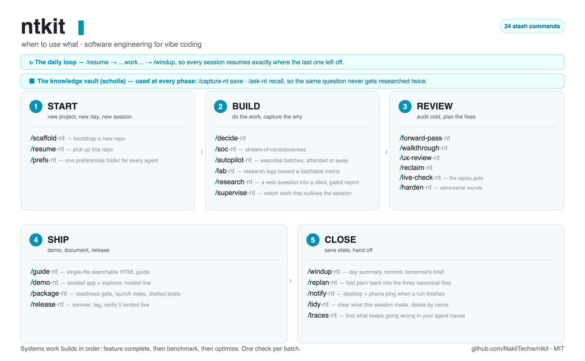

<h1 align="center">ntkit</h1>

<p align="center">
  <strong>Give your coding agent 23 skills to remember decisions, audit your project, and check that fixes work.</strong>
</p>

<p align="center">
  The skills are Markdown files. Installing them requires no ntkit account or server.
</p>

<p align="center">
  <a href="../../releases/latest"></a>
  <a href="LICENSE"></a>
  
  
</p>



## Install

Clone ntkit, then run the install command for your agent from the checkout.

```sh
git clone https://github.com/NakliTechie/ntkit && cd ntkit
```

| Agent | Install for your user account |
|---|---|
| Codex | `./install.sh "$HOME/.agents/skills"` |
| Claude Code | `./install.sh --claude "$HOME/.claude/skills"` |
| OpenCode | `./install.sh "${XDG_CONFIG_HOME:-$HOME/.config}/opencode/skills"` |

For another agent that loads [Agent Skills](https://agentskills.io/specification), pass its skills directory to `./install.sh`. The Claude option adds autocomplete hints. For upgrades, move any differing installed copies aside and rerun the installer.

Try a read-only project review. Open the project in your agent and ask for this skill. It reports findings with file locations and a proposed work plan.

```text
Use the forward-pass-nt skill to review this project.
```

You can also type `$forward-pass-nt` in Codex, `/forward-pass-nt` in Claude Code or `@forward-pass-nt` in OpenCode v2. The examples below use Claude’s slash notation. Browser and independent review steps require those capabilities in your agent.

To try ntkit in just one project, pass an absolute path inside that project to the same installer. Use `.agents/skills` for Codex, `.claude/skills` with `--claude` for Claude Code, or `.opencode/skills` for OpenCode.

## Why

When you switch agents or start a new session, you can lose the reason for a decision and the list of unfinished work. ntkit keeps both in your repository. Its review skills can inspect the whole app and name the check that proves a fix works.

## Pick up where you stopped

Each repo keeps a gitignored `plan/` folder with three files: `history.md` (decisions, log, dead ends), `pending.md` (now, parked, open questions) and `workplan.md` (chunked, checkboxed work). Set `NT_PLAN_STORE` to keep every plan in one backed-up folder ([MEMORY.md §0](MEMORY.md#0-where-plan-lives)). `/windup-nt` writes them at the end of a session. `/resume-nt` reads them at the start and names the state.

The `-nt` suffix keeps the skill names distinct from other installed commands.

## Carry your preferences across agents

Every new agent asks again who you are, how you write and how you work. `/prefs-nt init` gathers the answers from the global files your agents already have into one folder of markdown you own. `/prefs-nt sync` writes the global file of each installed agent from that folder: Claude Code, Codex, Gemini CLI, opencode, goose and amp. Agents append what they learn to an inbox that reaches the others at the next sync, and `/prefs-nt fold` sorts it in. `plan/` keeps what one repo knows; this folder keeps what holds in every repo.

## Run it unattended

`/autopilot-nt` works a workplan overnight in its own worktree. It merges a green gate to main and holds a red one on its own branch.

The example uses the Claude Code CLI. Other hosts need their own non-interactive runner and permissions.

```cron
0 2 * * *  cd ~/code/myproject && timeout 6h claude -p "/autopilot-nt" --dangerously-skip-permissions >> ~/.ntkit-cron.log 2>&1
```

`--dangerously-skip-permissions` does what it says, so schedule only commands that carry their own guardrails. The morning report is what `/resume-nt` reads.

## Commands

```
/scaffold-nt            # new project: folder, git, remote, seeded plan/, verification budget
/resume-nt              # start of session: read the handoff, name the state, wait or go
/decide-nt "<why>"      # mid-session: append a dated one-line decision
/soc-nt "<thought>"     # mid-build: raw thought; /replan-nt triages it later
/autopilot-nt           # anytime: work a workplan or goal, unattended, in its own worktree
/lab-nt                 # research: shape an idea into a falsifiable contract, run bounded legs
/research-nt "<q>"      # research: a web question into a cited report; drafts the plan, then runs
/forward-pass-nt        # anytime: fresh-eyes whole-app audit, batched fix-workplan
/walkthrough-nt         # anytime: drive each role (browser, CLI, TUI, API), fix bugs, leave a harness
/ux-review-nt           # anytime: cold first-timer review, ranked onboarding and nav failures
/reclaim-nt             # upkeep: find the GB in old weights, worktrees, archives; Trash only on apply
/tidy-nt                # upkeep: clear what this session created; lists first, deletes by name
/traces-nt              # upkeep: investigate your agent traces (tracelens); findings with fix targets
/live-check-nt          # verifying to shipped: the real deployed runtime, machine evidence
/harden-nt              # before "ready": map a surface's paths, harden each in rounds
/guide-nt               # anytime: walk each role, build a single-file searchable HTML guide
/demo-nt                # live demo: seeded app and explorer; host=<name> serves it via a tunnel
/package-nt             # launch: readiness gate, screenshots, launch video, drafted posts
/release-nt             # launch: semver, CHANGELOG, tag, push, verify the deploy live
/windup-nt              # end of session: day summary, pending, commit and push, tomorrow's handoff
/replan-nt              # occasionally: fold accumulated files back into the three canonical ones
/notify-nt              # after a run: desktop notification and optional phone push
/prefs-nt               # any agent: one preferences folder, written into every agent's global file
```

The knowledge vault is a separate tool, [scholia](https://github.com/NakliTechie/scholia): `/capture-nt <url|file>` saves a source, `/ask-nt <question>` answers only from the vault, with citations, and `/panel-nt <question>` puts one question to several models and ranks their answers (`--mine` asks which published technique fits a slow spot). `/research-nt`, `/lab-nt` and `/scaffold-nt` check the vault before the web. The review skills (`/forward-pass-nt`, `/ux-review-nt`, `/walkthrough-nt`, `/harden-nt`) follow the same probe-first rules when they call another model family. Without scholia they search the web and nothing else breaks.

## Verify it yourself

```bash
tests/run.sh
evals/run.sh --dry-run decide-nt-appends-one-line   # preview one model evaluation and its budget
```

The local suite checks the skill files, both install formats, bundled scripts and evaluation fixtures. For model-based checks, the evaluation runner uses Claude Code and requires a separate login. See [the evaluation instructions](AUTHORING.md#11-test-it).

## License

MIT © Chirag Patnaik. The skill authoring standard draws on [pi-workflows](https://github.com/osolmaz/pi-workflows). `/reclaim-nt` scans with a fork of [disktree](https://github.com/tobi/disktree) by Tobias Lütke (MIT). `/research-nt` adapts prompts from [LongCat-DeepResearch](https://github.com/meituan-longcat/LongCat-DeepResearch) by Meituan's LongCat team (MIT). `/package-nt` renders its launch video with [brag](https://github.com/latent-spaces/brag) by Shunit Haviv Hakimi (MIT), vendored with its license. The diff-review method and scanner list in `/forward-pass-nt` come from [OpenQodex](https://github.com/openqodex/openqodex) by the OpenQodex team (Apache-2.0).

[AUTHORING](AUTHORING.md) · [STATES](STATES.md) · [ATTEST](ATTEST.md) · [SUBSTANCE](SUBSTANCE.md) · [MEMORY](MEMORY.md) · [DRIVER](DRIVER.md) · [CHANGELOG](CHANGELOG.md) · [github.com/NakliTechie](https://github.com/NakliTechie)
